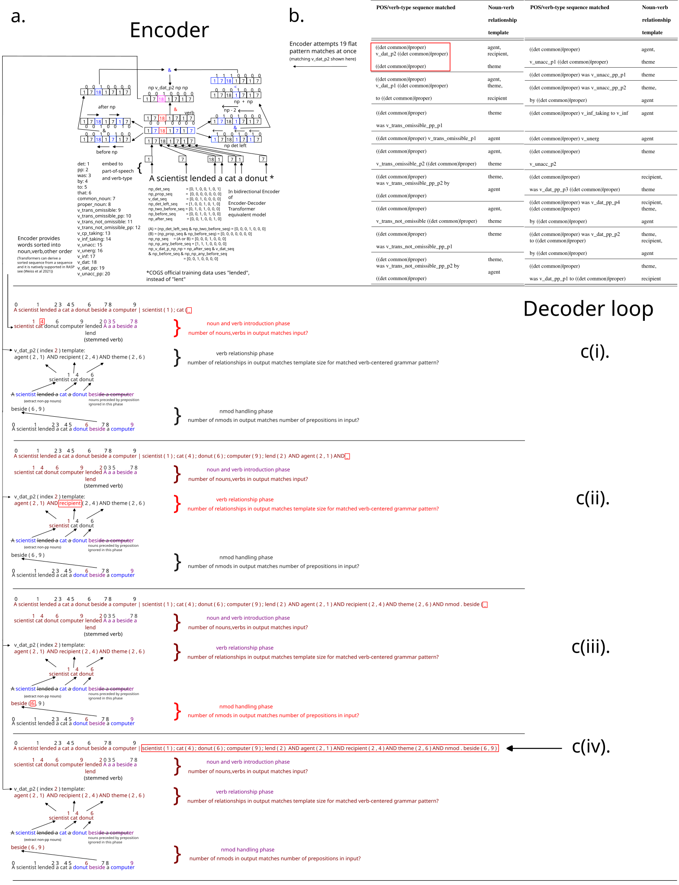
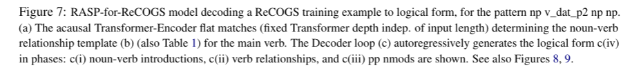
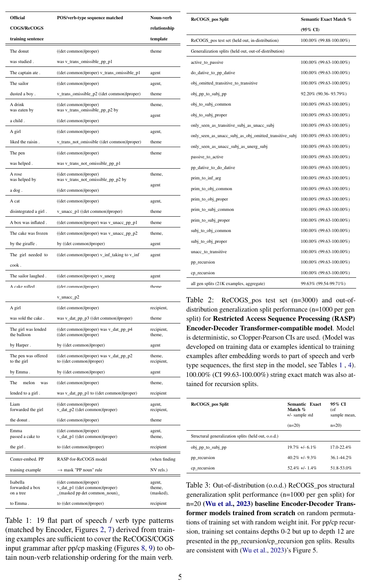
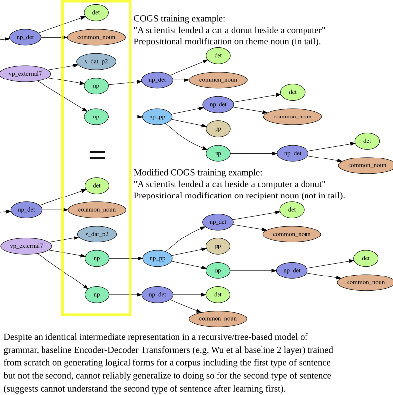

## RASP-for-(Re)COGS paper repository

**UPDATE (2025-04-22)**: Preprint for RASP-for-ReCOGS_pos went up on arXiv: https://arxiv.org/abs/2504.15349 !

This repo contains a [paper in progress](https://raw.githubusercontent.com/willy-b/RASP-for-ReCOGS/main/rasp-for-recogs_pos-and-cogs-wbruns-2025-draft.pdf)

describing a Restricted Access Sequence Processing language model which performs the COGS (see Kim and Linzen 2020) and ReCOGS_pos (see Wu et al 2023, "ReCOGS: How Incidental Details of a Logical Form Overshadow an Evaluation of Semantic Interpretation", https://arxiv.org/abs/2303.13716 for task description) tasks of translating sentences in a limited subset of English grammar into logical forms. This work is an attempt to prove-by-construction that a Transformer can learn to perform the (Re)COGS tasks in a compositional, systematic, length generalizing way and try to understand why some of the specific errors discussed by Wu et al 2023 are observed. We achieve near perfect Semantic Exact Match (ReCOGS) and String Exact Match (COGS) accuracy on the test set and all generalization splits using a flat, non-tree Transformer compatible RASP model. Most importantly, our results suggest that Transformers can perform the (Re)COGS task accurately even for novel prepositional phrase substitution positions or structural recursion depths unseen in training by achieving near perfect accuracy on the notoriously difficult 3 structural generalization splits (Our COGS model achieves perfect 100% String Exact Match for the previously reported as most difficult obj-pp-to-subj-pp split) without introducing a tree-structured bias (contrary to (Kim and Linzen, 2020), (Yao and Koller, 2022), (Murty et al., 2022), (Liu et al., 2021)). The models use 19 Transformer attention-head compatible grammar pattern recognizers plus some general attention-head compatible prepositional phrase/complement phrase handling rules (which handle phrase recursion using the decoder loop), and also gets high scores on the generalization splits [(see paper)](https://raw.githubusercontent.com/willy-b/RASP-for-ReCOGS/main/rasp-for-recogs_pos-and-cogs-wbruns-2025-draft.pdf). We predict some details of errors made by Wu et al 2023's Transformer on the previously reported most difficult split obj-pp-to-subj-pp, and successfully predict a new generalization split that is as hard as the obj-pp-to-subj-pp split based on the hypothesis that any center embedded prepositional phrase in a new position will be hard for a non-tree structured/non-hierarchical/non-recursive model that has not learned the alternate strategy of pp masking during noun-verb extraction (added to our RASP-for-ReCOGS model and argued potentially learnable from sparse center embedded pp training examples).

What is Restricted Access Sequence Processing (RASP)? It is a language that can be compiled to Transformer weights, designed to help one in "Thinking Like Transformers" (title of Weiss et al 2021 paper, https://arxiv.org/abs/2106.06981 ,  which introduced it).

The code for the projects (RASP-for-COGS and RASP-for-ReCOGS) that this paper describes the results of are available MIT-licensed at:

- RASP-for-COGS code: https://github.com/willy-b/RASP-for-COGS

- RASP-for-ReCOGS code: part of the https://github.com/willy-b/learning-rasp repository ( recogs_examples_in_rasp.py and word-level-pos-tokens-recogs-style-decoder-loop.rasp , specifically, see also the README, noting that some other RASP programs are also there, may move the RASP-for-ReCOGS implementation into this repository later )

Example RASP model flat grammar pattern matching case (np v_dat_p2 np np) to determine the template for mapping nouns to noun verb relationships (full Encoder-Decoder illustration for the ReCOGS model):

Results preview (read [paper](https://raw.githubusercontent.com/willy-b/RASP-for-ReCOGS/main/rasp-for-recogs_pos-and-cogs-wbruns-2025-draft.pdf) for details):

New difficult generalization split v_dat_p2 recipient pp modification, which is NOT expected to be difficult under a parse-tree representing model, was predicted by a flat linear pattern matching model and confirmed as difficult as the previously reported most difficult generalization split for the baseline Encoder-Decoder Transformers trained from scratch:

### References

[See paper](https://raw.githubusercontent.com/willy-b/RASP-for-ReCOGS/main/rasp-for-recogs_pos-and-cogs-wbruns-2025-draft.pdf) for bibliography.

### Background

Note this work started from a final project for Stanford's excellent XCS224U class ( https://digitalcredential.stanford.edu/check/24288227F20DD8486799B5FF5E8C04CB440129EC0DE44FEB65C4BAFABDBAA68BQWtzR2p1TG45dHowNWg5dXp6UW1kNmdYVVExekNJa1V3R2J5aFdhWi9Lb01MakFZ ). RASP-for-ReCOGS was implemented as a self-directed final project for that class, but RASP-for-COGS was implemented independently afterwards.

You can find out more about the content of that course and the Stanford AI Professional Program by visiting the links provided on the certificate above or visiting the professor's excellent public course repository at https://github.com/cgpotts/cs224u (no endorsement from the professor implied by linking to them).